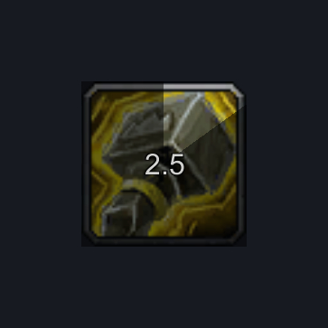
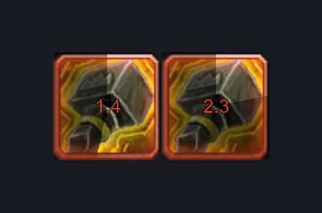
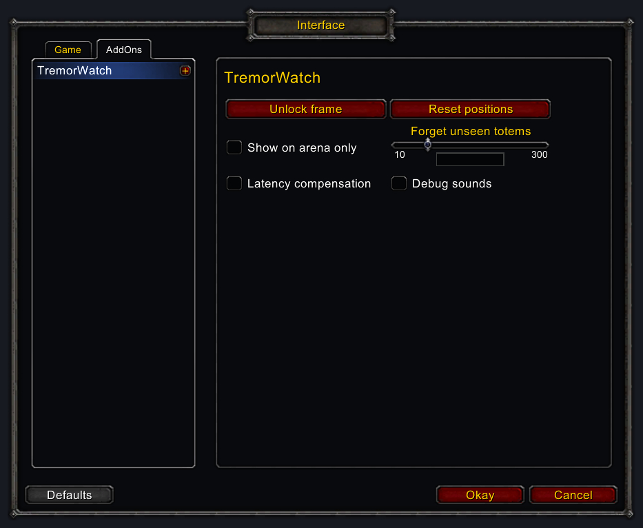
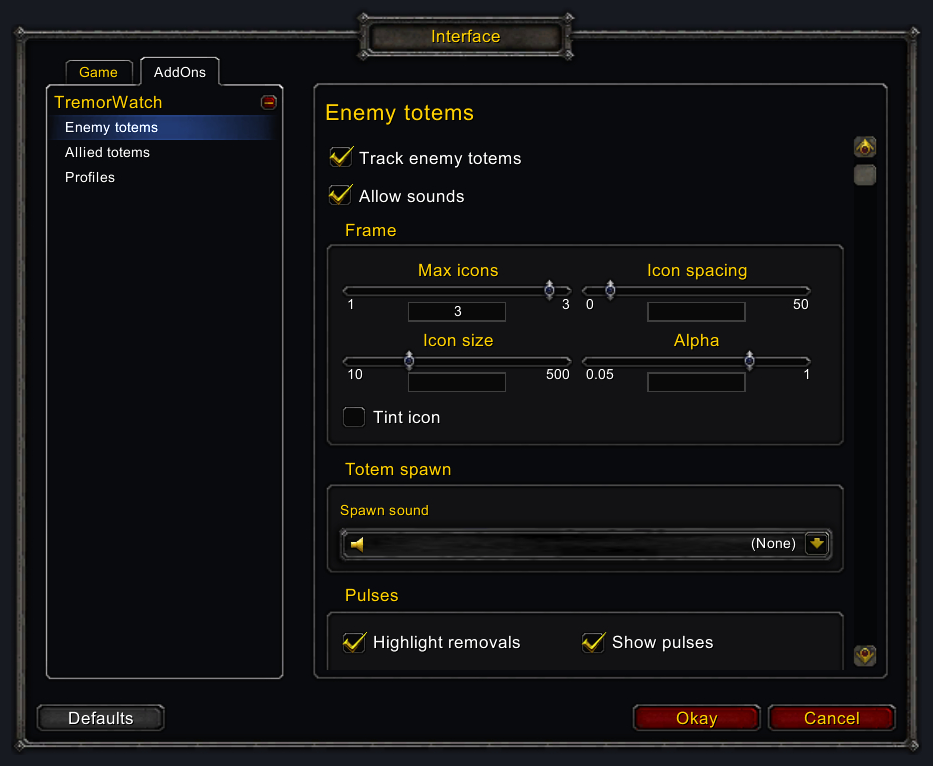
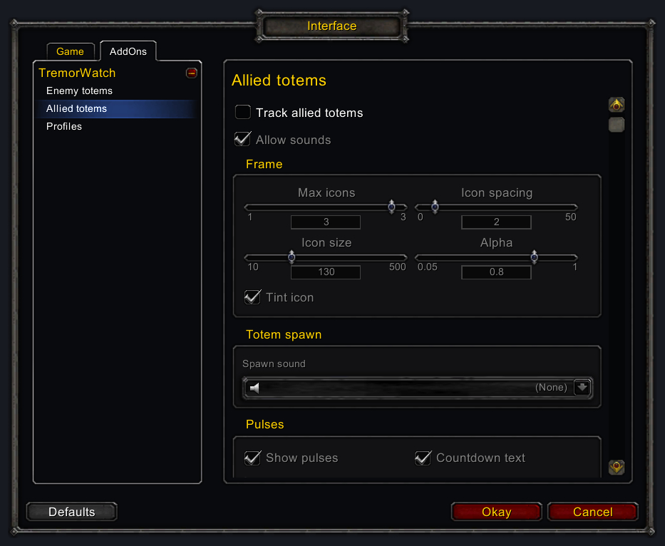

# TremorWatch

World of Warcraft 3.3.5a addon. Shows an icon when an enemy Tremor Totem is nearby, with a swirl and a countdown to
its next pulse and an optional sound on each pulse.

## Screenshots

## Options

`/tw` (or `/tremorwatch`) opens the options panel (Interface Options > AddOns > TremorWatch).

Enemy and allied totems each have their own frame (own position, size and settings). Unlock the frames to see a fake
totem on each and drag them; allied totems are off by default.

- **TremorWatch** (main panel, shared)
  - **Unlock frame / Lock frame** button (unlocked, as many fake totems as its **Max icons** are shown on each
    frame, so you can drag it and check spacing and size), **Reset positions**, **Show on arena only** (ignore totems outside arenas; the combat log is not read
    there at all), **Forget unseen totems** (outside arenas, drop a totem when neither it nor its shaman was seen for
    that long), **Latency compensation** (pulses follow the server's clock, half your latency earlier), and
    **Debug sounds** (the fake totems shown while the frames are unlocked also play their spawn and pulse sounds;
    silent by default).
- **Enemy totems** and **Allied totems** (sub-panels, same settings, own values)
  - **Track enemy / allied totems** (enemies default on, allies off).
  - **Allow sounds** (default on) - off silences every sound of that frame, whatever its own sound settings.
  - **Frame** - **Max icons** (1-3; each shown totem gets its own icon, oldest on the left, more are counted as "+N"
    on the last icon), **Icon spacing**, **Icon size**, **Alpha**, **Tint icon** (red for enemies, green for allies; on by default for allies only).
  - **Totem spawn** - **Spawn sound**: played when a totem appears (it replaces the pulse sound of the summon itself).
  - **Pulses** - **Show pulses** (swirl), **Countdown text**, **Pulse sound** (sound on each pulse, independent of
    the swirl). Enemies also have **Highlight removals** (the icon glows while an enemy has a fear, charm or sleep
    effect - Psychic Scream, Fear, Seduction, Wyvern Sting, ... - that the next pulse will remove).
  - **Totem destroyed** - **Flash** (grey icon for a second) and **Destroyed sound** when a shown totem is destroyed.
  - Sounds are chosen from the LibSharedMedia list in a dropdown with a **Play** button; **(None)** at the top of each
    list means no sound. Names read "name - addon" ("Bell - CombatTracking" for another addon's "CombatTracking Bell"). Bundled: mallet (default enemy pulse sound), tick, blip (pulses), rise, ding-dong (spawn),
    shatter, fall (destroyed). Allied sounds default to None. The WAVs are made by `tools/gen_sounds.py`.
- **Profiles** (sub-panel) - each character uses one profile (default "Default"); characters on the same profile share
  all settings and positions. **Current profile**, **New profile** (starts with default settings), **Copy from**,
  **Delete profile** (not the one in use), **Reset profile**. Settings saved before profiles existed become "Default".

Slash commands: `/tw lock` / `/tw unlock` (`/tw test` toggles), `/tw reset` resets the frame positions, `/tw profile <name>` switches profile.

## License

MIT, see `LICENSE`. The bundled libraries in `libs/` (Ace3, LibStub, CallbackHandler, LibSharedMedia-3.0, AceGUI-3.0-SharedMediaWidgets) keep their own licenses.
